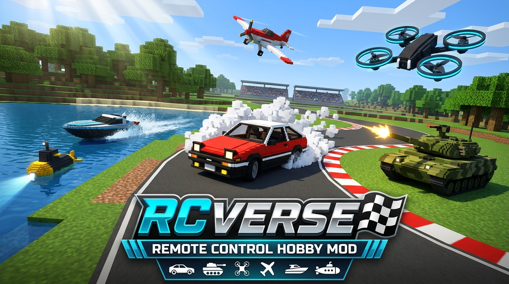
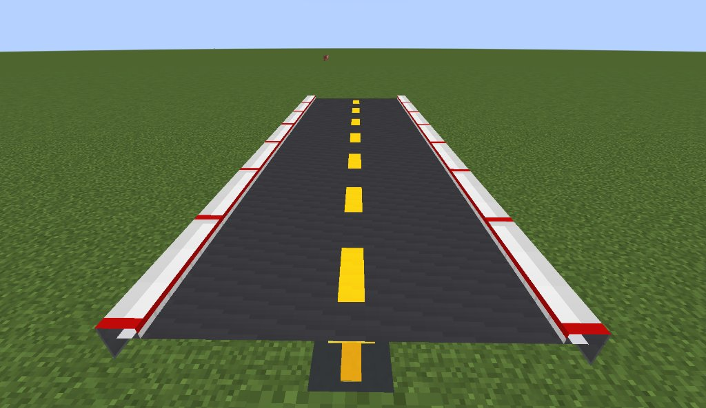
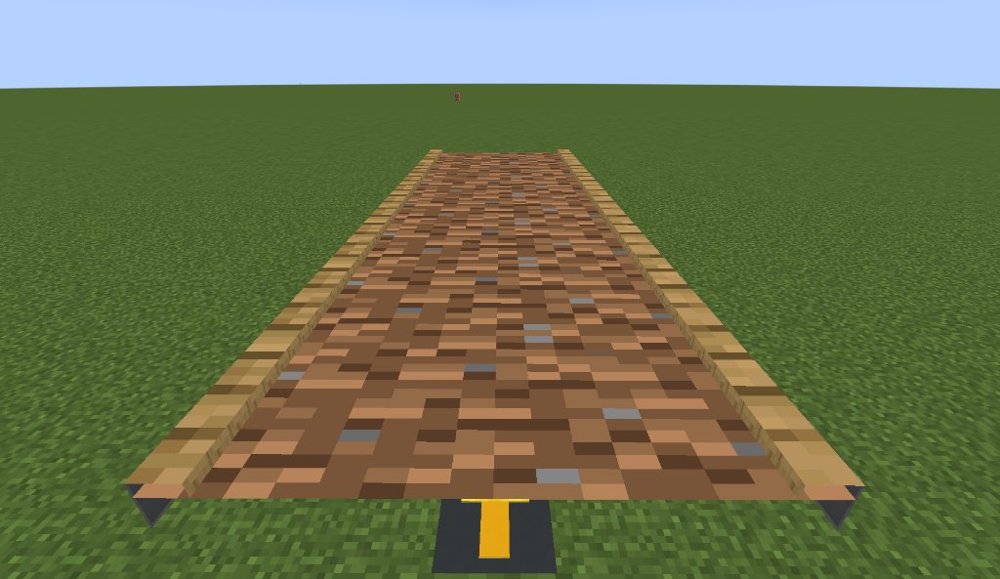
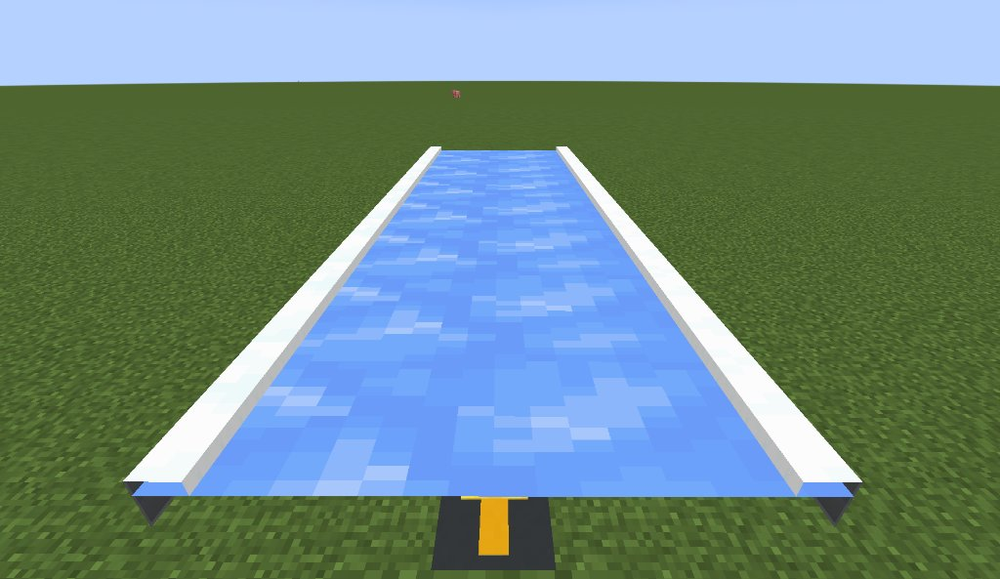
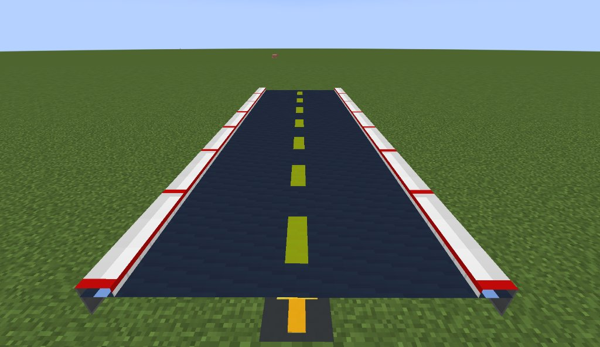

# RCVERSE - Remote Control Hobby MOD

**"Bring the ultimate adult RC hobby experience into Minecraft!"**  
Drive, fly, sail, customize, and build your dream tracks with full physics, realistic transmitters, and FPV cameras.

[🌐 Official Website (Web LP)](https://miku013.github.io/RCVERSE/) | [📥 CurseForge Page](https://www.curseforge.com/minecraft/mc-mods/rcverse) | [📖 日本語ガイド](#-japanese-description--日本語概要)

---

## 💡 About This Project (A Note from the Author)
> **Built from absolute scratch with zero prior coding knowledge, co-created step-by-step with AI.**  
> The creator of this MOD started this project with **zero programming experience**. Through hundreds of interactive sessions, brainstorming, and joint problem-solving with AI (Google Antigravity / Gemini), every single feature — from suspension kinematics and 3D GeckoLib entity rendering to network packet synchronization and ReplayMod compatibility — was engineered line by line.  
> This MOD is living proof that passion, curiosity, and human-AI collaboration can turn any creative dream into reality!

---

## 🌟 Key Features

- **🎮 Handheld RC Transmitter with Dual-Rate Controls**:
  - Full analog steering, throttle curves, dynamic throttle hold, and dual-rate sensitivity adjustments via an interactive GUI.
  - 3D GeckoLib transmitter in-hand, with animated control sticks that mirror your actual inputs.
- **🏎️ Land, Sea & Air — 6 Major Vehicle Categories**:
  - **RC Car (Drift & Touring)**: Authentic counter-steering, trail braking, handbrake slides, and smoke particles.
  - **FPV Micro Drone**: Quadcopter aerobatics with Acro / Angle modes, 3D flip maneuvers, and camera tilt.
  - **RC Tank**: Dual-track skid steering and 360° independently rotating cannon turret with recoil physics.
  - **RC Airplane**: Aerodynamic lift physics, elevator/aileron/rudder surfaces, propeller thrust, and smooth stall behavior.
  - **RC Speedboat**: Surface hull water resistance, bow lift, and high-speed wake spray particles.
  - **RC Submarine**: Full 6-DOF ballast buoyancy control, depth gauge, and underwater exploration floodlights.
- **📹 Live FPV Cockpit & CCTV Race Displays**:
  - Switch instantly between 3rd-person follow cam, bumper cam, drone FPV cockpit, and trackside fixed cameras.
  - In-world electronic billboard (`Race Display`) broadcasting live picture-in-picture CCTV footage of active vehicles.
- **🏁 Dynamic Mesh Spline Track Generator & Surface Types**:
  - Place **Road Generation Markers** to automatically generate smooth circuits, banked corners, kerbs, and **360° vertical loops**.
  - Choose between **4 track surfaces**: Asphalt (circuit pavement), Dirt (off-road trail), Ice (low-friction frozen track), and Water Puddle (hydroplaning hazards).

| Asphalt (Circuit) | Dirt & Gravel (Rally) | Ice (Low-Friction Drift) | Water Puddle (Wet Hazards) |
| :---: | :---: | :---: | :---: |
|  |  |  |  |
| Standard tarmac for grip & drift | Rough dirt with +35% off-road boost | Ultra-slick ice for extreme sliding | Puddle hazards with splash particles |
- **🛞 Performance Tire Tuning**:
  - Swap tires on the fly to master any track: **Normal** (all-round), **Drift** (slick resin for huge power slides), **Grip** (asphalt track soft slicks), **Off-road** (mud/dirt +35% accel boost), and **Spike** (metal studs for ice biting).
- **🎨 3D Decal Customizer & Workshop**:
  - Apply custom transparent PNG livery decals directly onto vehicle surfaces with real-time 3D translation, rotation, and scaling.
- **🧩 Custom Blockbench Models Supported**:
  - Effortlessly import custom vehicle models designed in Blockbench with multi-bone gecko hierarchies without writing code!
- **🎬 Cinematic Broadcast & ReplayMod Compatible**:
  - Broadcast simultaneous controls to multiple vehicles for synchronized drift sequences or multi-car convoy shots, fully compatible with ReplayMod recordings (`.mcpr`).

---

## 🚗 Vehicle Roster

| Vehicle | Class | Key Controls & Physics |
| :--- | :--- | :--- |
| **Hachiroku / Drift Car** | Land | Drift physics, handbrake, counter-steer, tire smoke, suspension travel |
| **Micro Drone** | Air | Acro / Angle flight modes, 3D flips, propeller thrust, FPV camera tilt |
| **Panzer Tank** | Land | Independent track skid steering, 360° turret traverse, cannon fire |
| **RC Airplane** | Air | Aerodynamic lift, pitch/roll/yaw control surfaces, landing gear |
| **Speedboat** | Water | Hydrodynamic planing, water wake particles, high-speed rudder turn |
| **RC Submarine** | Underwater | Ballast diving, underwater searchlights, neutrally buoyant cruising |

---

## 📦 Requirements & Installation

1. Install **Minecraft 1.21.1**.
2. Install **NeoForge 21.1.244** or higher.
3. Download and place **[GeckoLib 4 (v4.7.0+)](https://www.curseforge.com/minecraft/mc-mods/geckolib)** into your `.minecraft/mods` folder.
4. Download **RCVERSE** (`rcverse-1.21.1-1.0.0.jar`) from [CurseForge](https://www.curseforge.com/minecraft/mc-mods/rcverse) and place it in `.minecraft/mods`.
5. Launch the game and enjoy the ultimate RC hobby!

---

## ⌨️ Basic Controls

- **Spawn & Bind**: Right-click the ground with a vehicle item to deploy. Hold the **RC Transmitter (Propo)** in your hand and right-click the vehicle to bind.
- **Throttle / Steer**: Standard `W / A / S / D` keys.
- **Camera View**: Press `C` (default) to toggle between Third-Person Chase, Cockpit FPV, and Free Cam.
- **Handbrake / Drift**: `Spacebar` while turning to initiate a drift slide.
- **Transmitter Settings GUI**: Shift + Right-Click while holding the transmitter to adjust Dual-Rate, Throttle Expo, and FPV Camera Angles.

---

## 🇯🇵 Japanese Description / 日本語概要

### プロジェクト概要
**「大人の本気RC（ラジコン）ホビー体験をマインクラフトへ！」**  
プロポ（送信機）を手に持ち、実機さながらの操作感と物理演算、車載FPVカメラ、実物大の3Dモデルで陸・海・空の6大マシンを操縦できる本格RCホビーMODです。

### 主な特徴
- **陸海空6大マシン**: ドリフトカー、FPVドローン、戦車（砲塔独立旋回）、飛行機、ボート、潜水艦。
- **実機プロポ送信機**: アニメーションするスティック、デュアルレート・EXP調整GUI。
- **動的メッシュ道路＆4種の路面タイプ**: マーカーを置くだけで滑らかなカーブ、バンク、縁石、360度ループコースを自動生成。アスファルト・ダート・アイス・水たまりの路面切り替えに対応。

| アスファルト (標準サーキット) | ダート (未舗装ラリー) | アイス (氷上ドリフト) | 水たまり (ウェット路面) |
| :---: | :---: | :---: | :---: |
|  |  |  |  |
| 高速グリップ＆本格テールスライド | オフロードタイヤで加速+35%ブースト | 摩擦0.995の超スライド＆スパイクタイヤ対応 | 水しぶきエフェクト＆スリップ制御 |
- **5大タイヤパーツチューニング**: ノーマル、ドリフト、グリップ、オフロード、スパイクタイヤを用途に合わせて自由に換装可能。
- **デカール工房（リバリーエディタ）**: 車体に好きなステッカーを3D空間上で自由に配置・拡大縮小・回転。
- **自作モデル対応**: Blockbenchで作成したオリジナル車両モデルを簡単に導入可能。
- **ReplayMod・シネマティック対応**: 複数台の同時一斉操縦、美しいレース映像やドリフト動画の撮影が可能。

---

## 📄 License
Copyright © 2026 Miku. All rights reserved.  
Project assets and code are published under the All Rights Reserved license on CurseForge.
