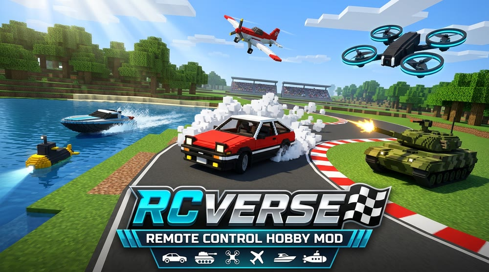
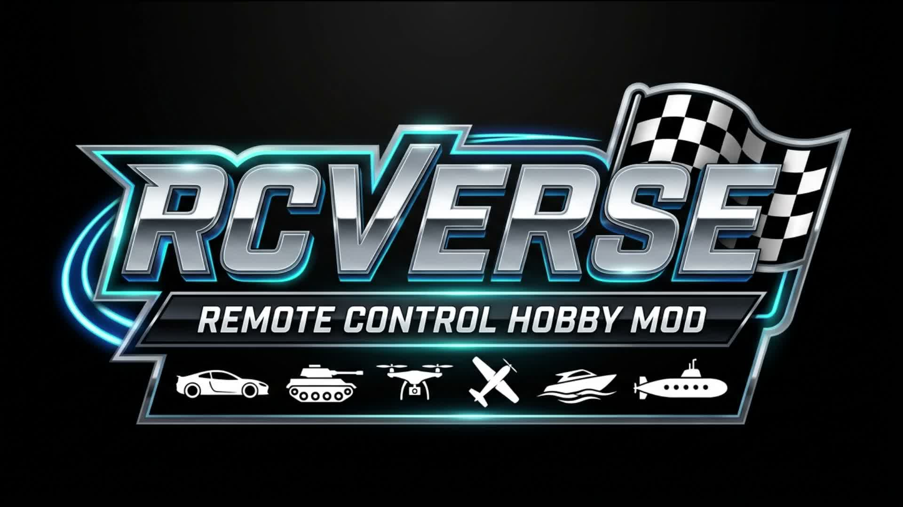
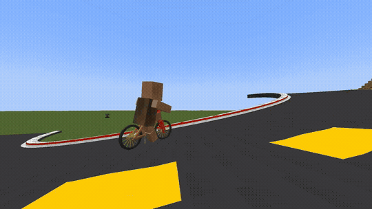
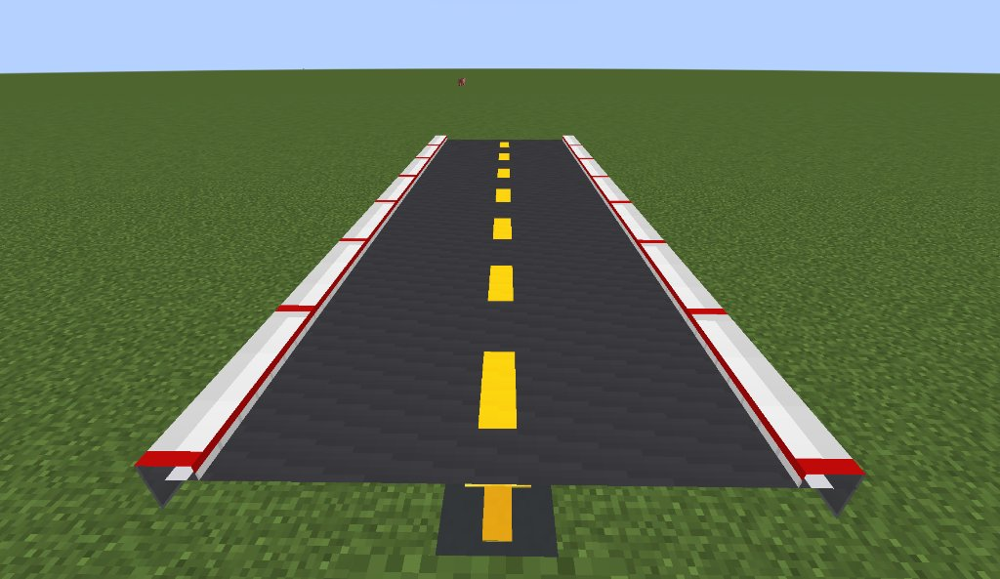
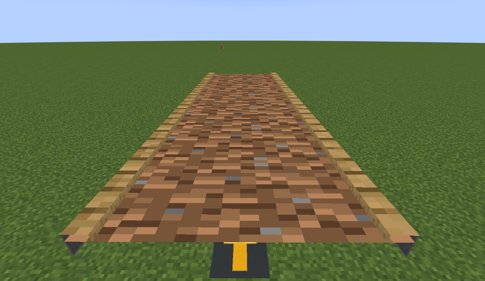
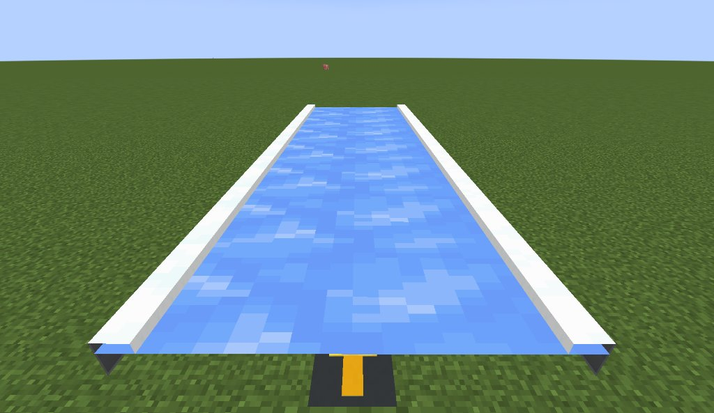
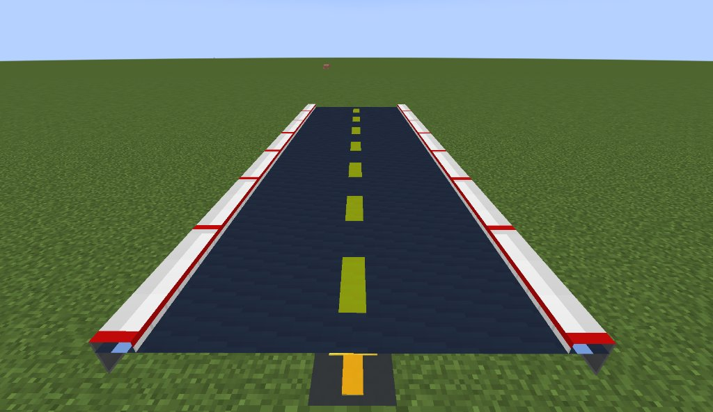
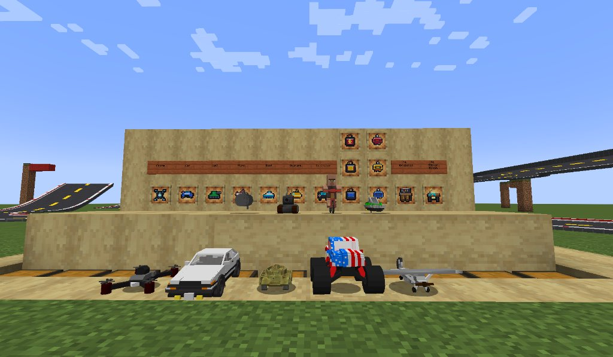
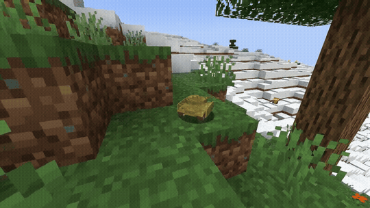

# RCVERSE - CurseForge Description Template

このファイルの内容をコピーして、CurseForgeのプロジェクト編集画面「**Description**」に貼り付けるだけで、美麗なバナーやGIF、YouTube動画リンク付きの公式ページが完成します！

---

## 📋 CurseForge 貼り付け用テキスト (HTML / Markdown)

```html
<p align="center">
  
</p>

<p align="center">
  <a href="https://youtu.be/rsyY97cwt14" target="_blank">
    
  </a>
  <a href="https://miku013.github.io/RCVERSE/" target="_blank">
    
  </a>
  <a href="https://github.com/Miku013/RCVERSE" target="_blank">
    
  </a>
</p>

<p align="center">
  <strong>Minecraft 1.21.1 / NeoForge / Requires GeckoLib 4</strong><br>
  <em>Turn Minecraft into the ultimate RC hobby sandbox! Control palm-sized micro machines with authentic physics, FPV cockpit cameras, and custom Blockbench models!</em>
</p>

<hr>

<p align="center">
  <a href="https://youtu.be/rsyY97cwt14" target="_blank">
    
    <br>
    <strong>▶️ Click to Watch the Official Introduction & Complete Guide on YouTube!</strong>
  </a>
</p>

<hr>

<h2>🏁 Dynamic Spline Tracks & Stunt Ramps</h2>

<p align="center">
  
  <br>
  <em>Smooth procedural asphalt tracks, high-speed banked corners, and big air stunt jump ramps!</em>
</p>

<p align="center">
  <strong>🛣️ 4 Diverse Track Surfaces (Asphalt, Dirt, Ice, Water Puddle)</strong>
</p>
<table align="center" style="width: 100%; text-align: center;">
  <tr>
    <td width="25%"><br><b>Asphalt</b><br><em>High-speed circuit</em></td>
    <td width="25%"><br><b>Dirt & Gravel</b><br><em>+35% off-road boost</em></td>
    <td width="25%"><br><b>Ice Lake</b><br><em>Extreme sliding</em></td>
    <td width="25%"><br><b>Water Puddle</b><br><em>Wet spray hazards</em></td>
  </tr>
</table>

<p>
  <strong>RCVERSE</strong> brings the authentic adult RC hobby into Minecraft.  
  Hold your handheld transmitter to steer micro-sized machines across land, sea, and air with dedicated physics engines tailored for every vehicle class:
</p>

<ul>
  <li>🏎️ <strong>RC Cars & Drift Machines</strong>: Independent multi-link suspension, throttle braking, and customizable grip/drift multipliers.</li>
  <li>🛸 <strong>Micro Drones & Quadcopters</strong>: Realistic acrobatic flips, pitch/roll/yaw flight physics, and propeller spin.</li>
  <li>💥 <strong>RC Battle Tanks</strong>: 360° turret traverse, cannon elevation, ground dust shockwaves, and animated barrel recoil!</li>
  <li>✈️ <strong>RC Airplanes</strong>: High-speed runway takeoff, stall aerodynamics, and graceful sky glides.</li>
  <li>🚤 <strong>RC Speedboats</strong>: Hydrodynamic water drag and high-speed wake spray.</li>
  <li>⚓ <strong>RC Submarines</strong>: Deep-sea buoyancy diving and exploration.</li>
  <li>🚲 <strong>RC Bicycles</strong>: Dual-wheel gyroscopic balance and handlebar steering.</li>
</ul>

<p align="center">
  
  <br>
  <em>Complete fleet ready to drive, tune, and race!</em>
</p>

<hr>

<h2>💥 Explosive Combat & RC Tank Battles</h2>

<p align="center">
  
  <br>
  <em>Independent turret rotation, high-explosive cannon shots, and realistic recoil kickback!</em>
</p>

<hr>

<h2>🎨 Import Custom Blockbench Models (Zero Coding Required!)</h2>

<p>
  Want to drive your own dream car or historical battle tank?  
  RCVERSE allows you to create custom 3D models in <strong>Blockbench</strong> and load them via standard Resource Packs and JSON configs without recompiling the mod!
</p>

<ul>
  <li>📦 <strong>Starter Template Kits Available</strong>: Download official starter kits for RC Cars and RC Tanks right from our <a href="https://miku013.github.io/RCVERSE/#custom-models">Official Website</a>.</li>
  <li>✨ <strong>Instant Anvil Renaming</strong>: Rename any RC vehicle on an Anvil to your custom model ID, and it instantly transforms in-game!</li>
</ul>

<hr>

<h2>🛠️ Requirements & Installation</h2>

<ol>
  <li>Ensure you are running <strong>Minecraft 1.21.1</strong> with <strong>NeoForge</strong>.</li>
  <li>Install <strong><a href="https://www.curseforge.com/minecraft/mc-mods/geckolib">GeckoLib 4</a></strong> (Mandatory dependency for 3D animations).</li>
  <li>Drop <strong>RCVERSE (.jar)</strong> into your <code>.minecraft/mods</code> folder.</li>
  <li>Launch Minecraft, grab a Transmitter and an RC vehicle, and have fun!</li>
</ol>

<hr>

<p align="center">
  🌐 <strong>For detailed tutorials, item recipes, and custom model templates, visit our <a href="https://miku013.github.io/RCVERSE/">Official Wiki</a>!</strong>
</p>
```
